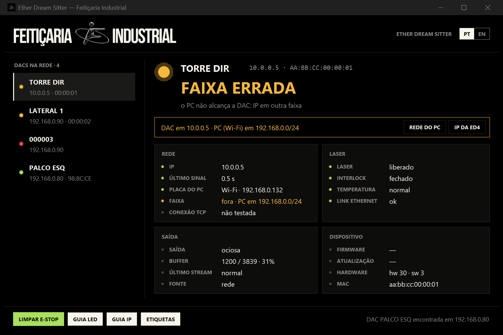
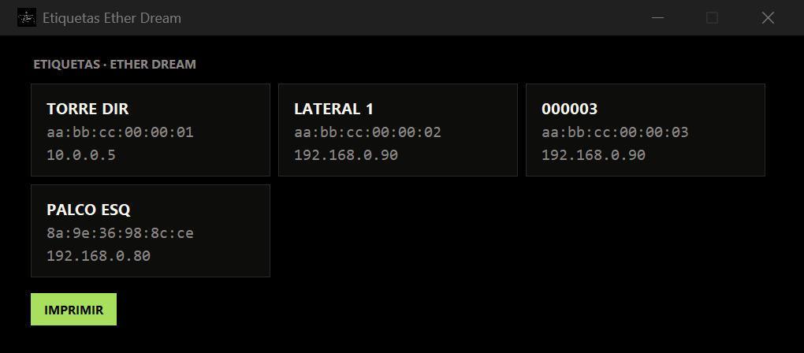
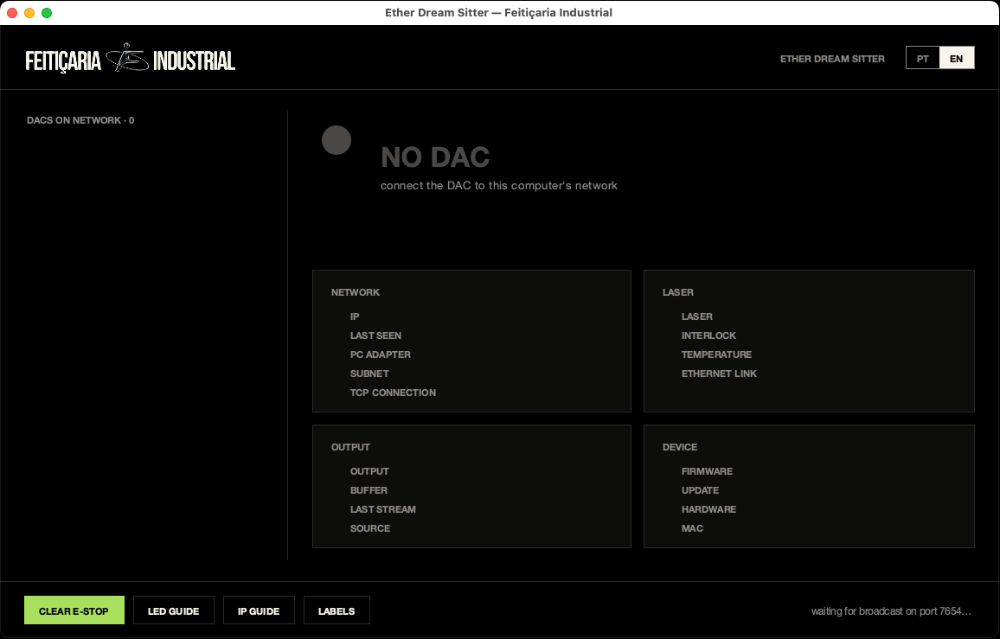

# Ether Dream Sitter — Feitiçaria INDUSTRIAL

Monitor de rede para DACs de laser **Ether Dream** (ED2, ED3, ED4). Mostra todas as DACs da rede, o estado de cada uma por cor de LED, avisa faixa de IP errada e IP duplicado, e limpa E-Stop. Windows e macOS (Apple Silicon). PT-BR / EN automático.

Network monitor for **Ether Dream** laser DACs (ED2, ED3, ED4). Lists every DAC on the network, color-coded status, wrong-subnet and duplicate-IP warnings, Clear E-Stop. Windows and macOS (Apple Silicon). PT-BR / EN auto-detected.



## Download

| Sistema | Arquivo |
|---|---|
| Windows 10/11 (x64) | [EtherDream-Sitter-FI.exe](https://github.com/MatheusMeM/etherdream-sitter-fi/releases/latest/download/EtherDream-Sitter-FI.exe) |
| macOS 11+ Apple Silicon (M1–M4) | [EtherDream-Sitter-FI-mac-arm64.zip](https://github.com/MatheusMeM/etherdream-sitter-fi/releases/latest/download/EtherDream-Sitter-FI-mac-arm64.zip) |
| Código-fonte | [Releases](https://github.com/MatheusMeM/etherdream-sitter-fi/releases/latest) |

**Windows:** o .exe não é assinado; no aviso do SmartScreen, *Mais informações → Executar assim mesmo*.

**macOS:** descompacte e arraste para Aplicativos. Na primeira vez, clique com o botão direito → *Abrir* (app sem notarização da Apple). Se o macOS disser que o app "está danificado":

```bash
xattr -dr com.apple.quarantine /Applications/EtherDream-Sitter-FI.app
```

Aceite o pedido de **Rede Local** — sem ele o app não vê as DACs.

## Recursos

- **Passivo:** lê só o broadcast UDP 7654. Na ED4 qualquer conexão TCP nova derruba o stream em andamento, então o sitter só conecta com a DAC parada (leitura de firmware) ou quando você clica em LIMPAR E-STOP.
- **Estado por LED:** OPERACIONAL, TOCANDO, PREPARADA, E-STOP (com causa: interlock, temperatura, comando de rede), OCUPADA, OFFLINE.
- **Rede:** placa do PC que vê cada DAC, faixa de IP errada (botões para abrir a rede do PC ou o guia de IP da ED4), IP duplicado.
- **Nomes:** dê nome a cada DAC ("PALCO ESQ") — clique lento no nome, F2 ou o lápis. Fica salvo no computador, não na placa.
- **Etiquetas:** prévia e impressão com nome, MAC e IP.
- **Guias:** cores do LED da ED4 e troca de IP via `ip.txt`.
- **Firmware:** mostra a versão e avisa quando há atualização.

| Etiquetas | macOS |
|---|---|
|  |  |

## Onde ficam os arquivos

| | Windows | macOS |
|---|---|---|
| Nomes das DACs | `etherdream_nomes.json` ao lado do .exe | `~/Library/Application Support/EtherDreamSitterFI/` |
| Log de erros | `%LOCALAPPDATA%\EtherDreamSitterFI\erro.log` | `~/Library/Logs/EtherDreamSitterFI/erro.log` |

## Rodar do código / build

Python 3.12+ com Tk 8.6 (no macOS, o Python do python.org). Sem dependências externas.

```bash
python sitter_fi.py
python test_sitter.py
```

Windows (.exe):

```bash
pip install pyinstaller
pyinstaller --onefile --windowed --name EtherDream-Sitter-FI --icon assets/fi.ico sitter_fi.py
```

macOS (.app, num Mac Apple Silicon): `bash build_mac.sh`. O workflow [build-mac](.github/workflows/build-mac.yml) faz o mesmo num runner M1 do GitHub a cada push.

## Licença

GPL-3.0 — ver [LICENSE](LICENSE). Derivado do `sitter` do projeto [j4cDAC](https://github.com/j4cbo/j4cDAC), Copyright 2012 Jacob Potter. Protocolo: [ether-dream.com/protocol.html](https://ether-dream.com/protocol.html).

Ether Dream é marca de seus respectivos donos; este projeto não é afiliado.
