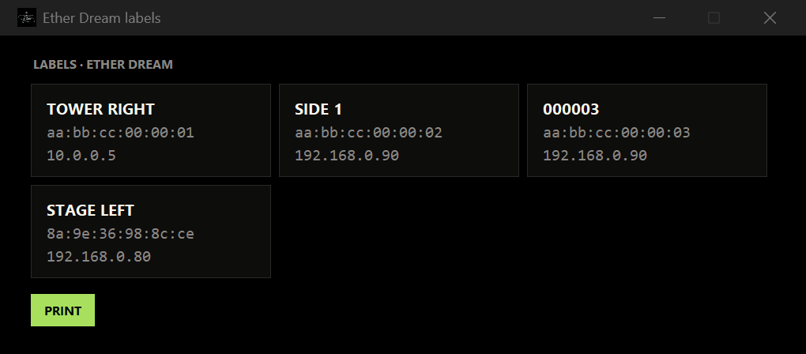

# Ether Dream Sitter — Feitiçaria INDUSTRIAL

Network monitor for **Ether Dream** laser DACs (ED2, ED3, ED4). Lists every DAC on the network with color-coded status, warns about wrong subnets and duplicate IPs, and clears E-Stop. Runs on Windows and macOS (Apple Silicon). UI in English and Portuguese, auto-detected.


## Download

| Platform | File |
|---|---|
| Windows 10/11 (x64) | [EtherDream-Sitter-FI.exe](https://github.com/MatheusMeM/etherdream-sitter-fi/releases/latest/download/EtherDream-Sitter-FI.exe) |
| macOS 11+ Apple Silicon (M1–M4) | [EtherDream-Sitter-FI-mac-arm64.zip](https://github.com/MatheusMeM/etherdream-sitter-fi/releases/latest/download/EtherDream-Sitter-FI-mac-arm64.zip) |
| Source code | [Releases](https://github.com/MatheusMeM/etherdream-sitter-fi/releases/latest) |

**Windows:** the .exe is not code-signed. On the SmartScreen prompt, choose *More info → Run anyway*.

**macOS:** unzip and drag to Applications. The app is not notarized, so the first time right-click it → *Open*. If macOS says the app "is damaged":

```bash
xattr -dr com.apple.quarantine /Applications/EtherDream-Sitter-FI.app
```

Allow the **Local Network** prompt — without it the app cannot see the DACs.

## Features

- **Passive:** reads only the UDP 7654 broadcast. On the ED4 any new TCP connection stops the running stream, so the sitter connects only when the DAC is idle (firmware read) or when you click CLEAR E-STOP.
- **Status by LED color:** OPERATIONAL, PLAYING, PREPARED, E-STOP (with cause: interlock, temperature, network command), BUSY, OFFLINE.
- **Network check:** which PC adapter sees each DAC, wrong subnet (buttons to open the PC network settings or the ED4 IP guide), duplicate IP.
- **Names:** give each DAC a name ("STAGE LEFT") — slow click on the name, F2, or the pencil icon. Stored on the computer, not on the DAC.
- **Labels:** preview and print with name, MAC and IP.
- **Guides:** ED4 LED colors and changing the IP via `ip.txt`.
- **Firmware:** shows the version and flags available updates.

| Labels | macOS |
|---|---|
|  |  |

## Files

| | Windows | macOS |
|---|---|---|
| DAC names | `etherdream_nomes.json` next to the .exe | `~/Library/Application Support/EtherDreamSitterFI/` |
| Error log | `%LOCALAPPDATA%\EtherDreamSitterFI\erro.log` | `~/Library/Logs/EtherDreamSitterFI/erro.log` |

## Run from source / build

Python 3.12+ with Tk 8.6 (on macOS use the python.org installer). No third-party dependencies.

```bash
python sitter_fi.py
python test_sitter.py
```

Windows (.exe):

```bash
pip install pyinstaller
pyinstaller --onefile --windowed --name EtherDream-Sitter-FI --icon assets/fi.ico sitter_fi.py
```

macOS (.app, on an Apple Silicon Mac): `bash build_mac.sh`. The [build-mac](.github/workflows/build-mac.yml) workflow does the same on a GitHub M1 runner on every push, launches the app and uploads a screenshot.

## License

GPL-3.0 — see [LICENSE](LICENSE). Derived from the `sitter` tool of [j4cDAC](https://github.com/j4cbo/j4cDAC), Copyright 2012 Jacob Potter. Protocol: [ether-dream.com/protocol.html](https://ether-dream.com/protocol.html).

Ether Dream is a trademark of its respective owners; this project is not affiliated with them.
